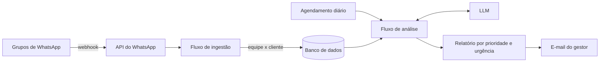

# Guardian AI

Agente que lê os grupos de WhatsApp entre uma empresa e seus clientes e entrega ao gestor, todo fim de dia, um relatório priorizado do que precisa de atenção.

## Problema

Empresas que atendem clientes por grupos de WhatsApp perdem visibilidade quando os grupos se multiplicam: o gestor não consegue ler tudo. Pedidos ficam sem resposta, mensagens em tom inadequado passam despercebidas e pendências se acumulam sem que alguém perceba a tempo.

## Solução

- Captura e armazena as mensagens dos grupos de atendimento pela API do WhatsApp.
- Separa automaticamente quem é da equipe da empresa e quem é do cliente.
- Ao fim do dia, analisa as conversas com um LLM e identifica:
  - mensagens grosseiras ou rudes;
  - solicitações em aberto e mensagens do cliente sem resposta;
  - pendências;
  - comportamento de clientes e da equipe.
- Monta um relatório ordenado por prioridade e urgência e envia por e-mail ao gestor.

## Como funciona

Detalhes em [docs/arquitetura.md](docs/arquitetura.md).

## Stack

- **Retool Workflows**: orquestração dos fluxos de ingestão e de análise diária
- **Retool Database**: mensagens e cadastro de contatos
- **Z-API**: integração com o WhatsApp
- **OpenAI e Anthropic (Claude)**: análise das conversas
- **Webhooks e APIs REST**
- **E-mail**: entrega do relatório

## Meu papel

Projetei e construí a solução de ponta a ponta para uma empresa parceira: integração com o WhatsApp, modelagem dos dados, fluxos no Retool, prompts de análise e formato do relatório.

## Status e resultados

- Implantado em uma empresa parceira, em um número pequeno de grupos.
- Entregue para operação do próprio parceiro.

## O que aprendi

- **Dor específica não basta:** o problema era claro (o gestor sem visibilidade dos grupos), mas a ferramenta também precisa ser vista e ouvida. Distribuição faz parte do produto.
- **Oferta e venda valem mais do que a ideia e a construção em si**, e a velocidade decide muita coisa.

## Contato

[guilhermesint.gerencia@gmail.com](mailto:guilhermesint.gerencia@gmail.com) · portfólio [guilhermevictaliano.github.io](https://guilhermevictaliano.github.io) · LinkedIn [linkedin.com/in/guilherme-victaliano-de-meira-b73933343](https://www.linkedin.com/in/guilherme-victaliano-de-meira-b73933343)

---

## English

**Guardian AI** is a low-code AI agent that monitors the WhatsApp groups a company keeps with its clients.
It stores every message, tells team members apart from clients and, at the end of each day, runs the conversations through an LLM.
The model flags rude messages, open requests, unanswered client messages and pending items.
The manager receives a report by email, sorted by priority and urgency. Deployed at a partner company on a small set of groups.
Built with Retool Workflows, Retool Database, Z-API (WhatsApp), OpenAI and Claude. Flows are private; demo on request.
