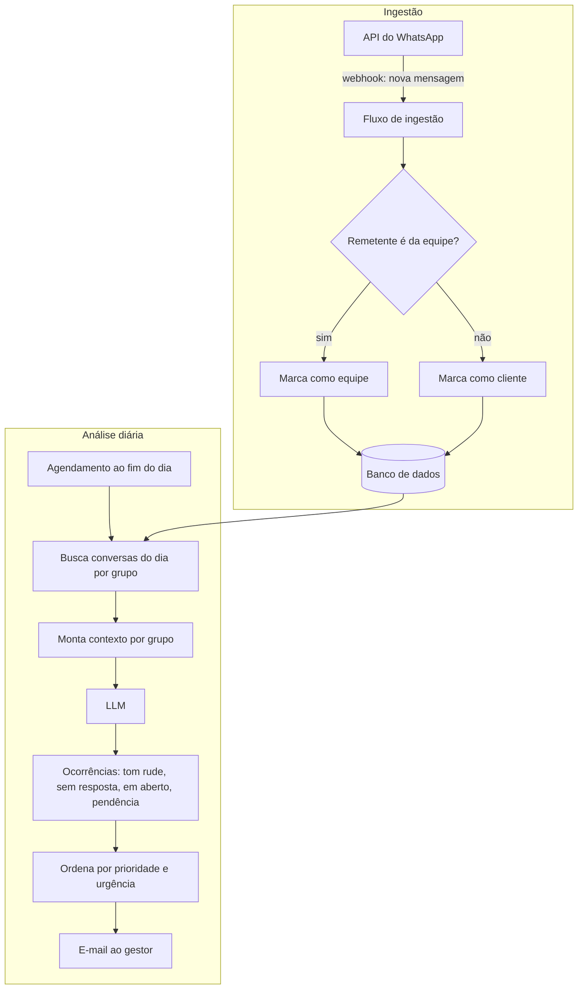

# Arquitetura: Guardian AI

## Visão geral

O sistema tem dois fluxos independentes que se encontram no banco de dados:

1. **Ingestão (contínua):** cada mensagem dos grupos chega por webhook, é classificada pelo remetente (equipe ou cliente) e gravada.
2. **Análise (diária):** um agendamento lê as conversas do dia, envia ao LLM e transforma a resposta em relatório.

## O que é regra e o que é IA

| Etapa | Tipo |
|---|---|
| Receber e gravar mensagens | Regra (webhook + banco) |
| Separar equipe x cliente | Regra (cadastro de contatos) |
| Detectar tom rude, pedidos em aberto, falta de resposta e pendências | IA (LLM) |
| Ordenar por prioridade e urgência e enviar o e-mail | Regra sobre a saída do LLM |

## Decisões técnicas

- **Análise em lote, uma vez por dia:** o gestor recebe um resumo único em vez de alertas soltos, e o custo de LLM fica previsível.
- **Separação equipe x cliente antes do LLM:** o modelo recebe a conversa já rotulada, o que deixa a análise mais simples de instruir ("o cliente ficou sem resposta?").
- **Mais de um provedor de LLM:** OpenAI e Claude disponíveis no mesmo fluxo.
- **Low-code (Retool):** banco, fluxos e agendamento na mesma plataforma, sem servidor próprio para manter.
